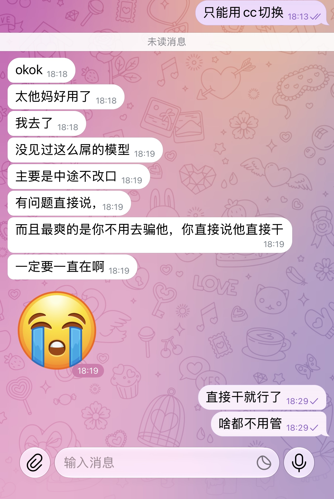

# 🔥 Codex破甲 · DeepSeek破甲｜NB破甲自研模型

### 主打「0拒绝」定位 · 直接表达需求 · 更少反复拉扯

**Codex · codex破甲 · DeepSeek · DeepSeek破甲 · 破甲社区**

**[🌐 进入 NB破甲官网](https://nbpojia.lol)　｜　[💬 加入 Telegram 群](https://t.me/HaoNB_6666)**

> **把目标讲清楚，把任务交过来。**
> **少一点来回试探，多一点实际推进。**
> **NB破甲：任务给到，直接开干。**

---

## 📣 新公告：NB-model-v2｜任务给到，直接开干

**少废话，重交付。带着真实需求来体验 NB破甲自研模型。**

[👉 阅读完整模型体验公告](ANNOUNCEMENT.md) · [🌐 官网体验入口](https://nbpojia.lol) · [💬 加入 TG 群](https://t.me/HaoNB_6666)

**从 codex、codex破甲、破甲、DeepSeek 或 DeepSeek破甲 搜过来的朋友，可以在这里了解模型介绍、用户反馈与社群入口。**

## 🚀 这次，主打一个干脆

写代码、改项目、拆需求、做方案、整理资料——你需要的是能围绕任务往下推进的协作体验。

**NB破甲自研模型，主打「0拒绝」的产品定位，追求更直接的沟通、更连贯的任务协作。**

不用把正常需求绕成谜语。把目标、材料和交付要求一次说明白，让对话围绕你真正要完成的事情展开。

**想写什么，直接说；想改哪里，直接给；需要什么结果，明确交付。**

[👉 去官网查看当前可用模型](https://nbpojia.lol) · [👉 进 TG 群交流使用体验](https://t.me/HaoNB_6666)

## 💬 用户怎么说

以下摘自站方提供的聊天反馈截图：

> “主要是中途不改口”
>
> “有问题直接说，”
>
> “而且最爽的是你不用去骗他，你直接说他直接干”

这几句话说中了我们希望打磨的体验：**需求直接讲，问题直接说，任务持续推进。**

[查看完整公告与反馈说明](ANNOUNCEMENT.md)

以上是个别用户的主观体验，原对话未提供完整任务、模型版本或测试条件，不作为所有场景的性能保证。

## ⚡ 我们关注的使用体验

| 你关心的事 | 我们希望做到的事 |
| --- | --- |
| 需求说了半天还没进入正题 | 围绕明确目标，尽快进入任务 |
| 改了上一处，下一轮又丢了约束 | 保持目标和要求连贯，方便逐步迭代 |
| 遇到缺失信息，输出一堆空话 | 直接说明缺什么、卡在哪里 |
| 想要能继续用的结果 | 明确代码、文稿、步骤或方案的交付形式 |
| 使用时遇到问题找不到人 | 通过 Telegram 社群反馈和交流 |

这是产品体验方向，具体表现以所选版本和实际任务为准。

## 🛠️ 带着这些任务来试

### 编程与项目协作

把语言、运行环境、相关文件、错误信息和预期行为一起给出。从需求拆解，到代码修改，再到测试与交付，按步骤推进。

**可以这样提：**

> 我有一个 Python 项目。下面是相关代码和报错，请先定位问题，再给出修改后的完整函数、修改理由和验证步骤。

### 文案与内容生产

说明受众、渠道、语气和必须保留的信息，尝试公告、产品介绍、活动文案、教程改写等任务。

**可以这样提：**

> 帮我写一份面向开发者的产品公告，开头直接说亮点，保留官网和 TG 群链接，不编造测评数据，最后给出明确的体验入口。

### 需求拆解与方案整理

把想法变成清晰的步骤，明确输入、输出、依赖和验收要求，便于继续执行。

**可以这样提：**

> 把这个想法拆成可以逐项验收的任务清单，标明依赖、交付物和需要我补充的信息。

### 资料归纳与日常协作

提供需要整理的文本，说明目标格式，尝试摘要、对照、翻译、提纲和结构化整理。

**重点只有一句：把真实需求说明白，带着具体任务来体验。**

## 🌐 怎么开始

1. 打开 **[NB破甲官网](https://nbpojia.lol)**，查看当前提供的模型、接入方式与价格。
2. 按官网当前指引选择模型或客户端；名称与可用入口以站内显示为准。
3. 直接提供任务目标、必要上下文和希望拿到的结果。
4. 需要教程、更新信息或使用交流，加入 **[Telegram 社群](https://t.me/HaoNB_6666)**。

**入口在这里：**

- 🌐 官网：**https://nbpojia.lol**
- 💬 Telegram 群：**https://t.me/HaoNB_6666**
- 👤 联系管理员：**https://t.me/HaoNB_666**
- 📚 破甲教程：**https://nbpojia.lol/tutorials/armor**
- 🔌 API 教程：**https://nbpojia.lol/tutorials/api**

## ❓ 常见问题

**这里可以下载模型或软件吗？**

本仓库是纯文字的产品介绍与社区入口，不分发软件、模型权重或安装包。体验方式请查看官网。

**“0拒绝”是什么意思？**

这是站方的产品定位与体验目标，强调减少正常任务中的无效拒答和反复沟通；不代表任何输入、任何版本、任何场景都能获得回答或完成任务，也不等于结果百分百正确。

**怎么确认是否适合我的任务？**

用你自己的真实需求验证，保留模型名称、时间、输入和实际输出。单张聊天反馈不能替代覆盖不同任务的可复现测试。

**有什么型号、倍率、价格或额度？**

这些信息可能变化，以官网当前显示和站方最新公告为准。本页不编造参数、跑分或与其他模型的胜负结论。

**这是 Codex 或 DeepSeek 官方项目吗？**

不是。NB破甲是独立站方品牌，Codex、codex破甲、DeepSeek、DeepSeek破甲、破甲用于说明社区讨论与使用方向，不表示与 OpenAI 或 DeepSeek 存在官方隶属关系，也不表示本模型由它们提供或训练。

## 📣 反馈与交流

欢迎带着真实任务和使用反馈来群里交流。反馈时说明：使用的模型、任务目标、遇到的问题和期望结果；分享前删除 API Key、账号信息和私有资料。

**更直接地提需求，更认真地看结果。**

**NB破甲自研模型｜主打 0拒绝定位，任务给到，直接开干。**

### [🌐 立即前往官网](https://nbpojia.lol)　·　[💬 加入 Telegram 群](https://t.me/HaoNB_6666)

---

本页为 NB破甲站方宣传介绍；“自研”为站方提供的产品描述。本仓库未公开训练细节、权重或覆盖全部场景的拒答率测试。
